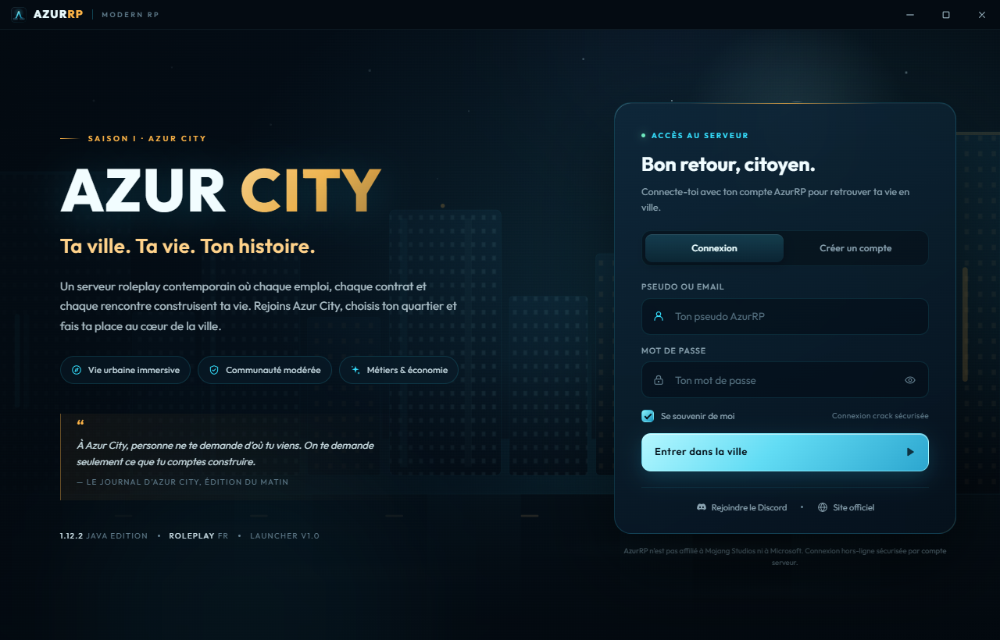
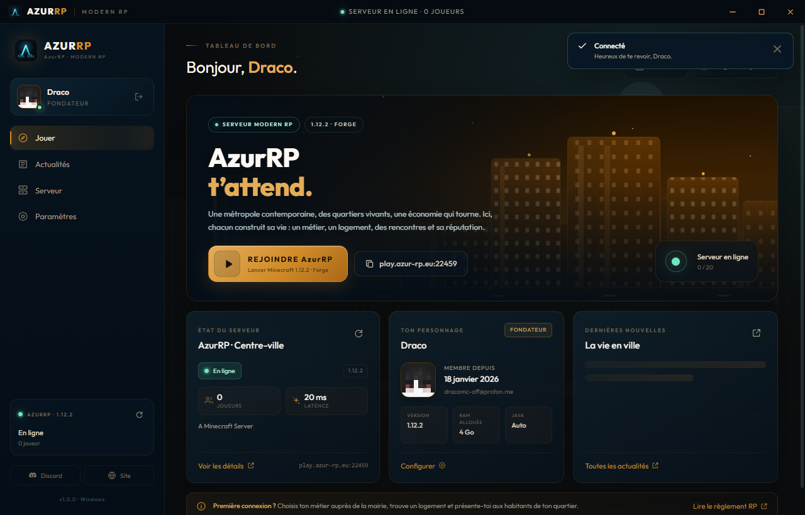
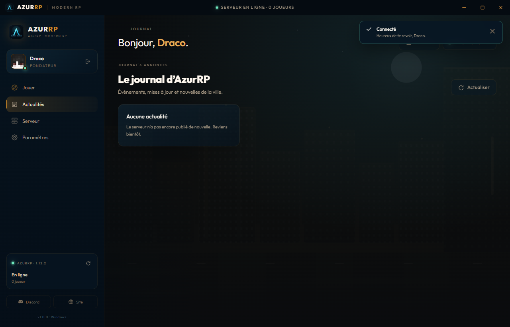
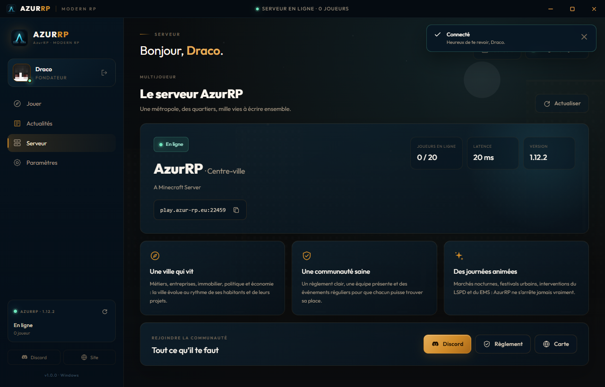
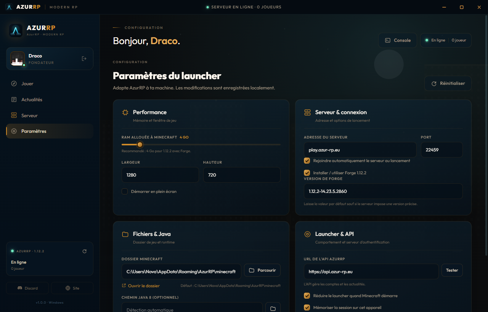

# AzurRP — Launcher Minecraft 1.12.2

Launcher officiel du serveur roleplay contemporain **AzurRP — Azur City**.
Interface Modern RP, connexion par pseudo/email, actualités intégrées, statut du
serveur en direct et lancement de Minecraft 1.12.2 avec Forge.



## Sommaire

- [Fonctionnalités](#fonctionnalités)
- [Architecture](#architecture)
- [Prérequis](#prérequis)
- [Démarrage rapide](#démarrage-rapide)
- [Configurer l'API](#configurer-lapi)
- [Développement](#développement)
- [Tests et contrôle qualité](#tests-et-contrôle-qualité)
- [Construire les installateurs](#construire-les-installateurs)
- [Obfuscation et limites](#obfuscation-et-limites)
- [Sécurité](#sécurité)
- [Dépannage](#dépannage)

## Fonctionnalités

- **Connexion hors-ligne (crack)** : pseudo + email + mot de passe, comptes
  stockés dans MySQL/MariaDB, mot de passe haché en bcrypt.
- **UUID hors-ligne déterministe** (`MD5("OfflinePlayer:<pseudo>")`) pour que
  les inventaires et les données de monde restent stables.
- **Minecraft 1.12.2 + Forge** : téléchargement automatique des fichiers
  vanilla, installation de Forge (`14.23.5.2860` par défaut), runtime Java 8
  détecté ou téléchargé.
- **Statut du serveur** en direct : joueurs en ligne, latence, MOTD, version.
- **Actualités et liens** pilotés par l'API, avec repli local si l'API est
  injoignable.
- **Console intégrée** avec coloration des erreurs et export des logs.
- **Paramètres complets** : RAM, résolution, Forge, dossier de jeu, Java,
  URL de l'API, connexion automatique.
- **Fenêtre sans cadre** thémée Modern RP (Azur City), icônes et illustrations
  SVG maison.
- **Multiplateforme** : Windows 10/11 (NSIS), Linux (AppImage + deb),
  macOS (dmg + zip, Intel et Apple Silicon).

| Tableau de bord | Actualités |
| --- | --- |
|  |  |

| Serveur | Configuration |
| --- | --- |
|  |  |

## Architecture

```
├── src/
│   ├── main/                 Processus principal Electron
│   │   ├── index.js          Fenêtre, IPC, cycle de vie, intégrité
│   │   ├── config.js         Valeurs par défaut et validation
│   │   ├── settings.js       Persistance des paramètres
│   │   ├── session.js        Jeton chiffré via safeStorage
│   │   ├── services/         API, Java, Minecraft, statut serveur
│   │   └── utils/            UUID hors-ligne
│   ├── preload/              Pont IPC sécurisé (contextBridge)
│   └── renderer/             Interface HTML/CSS/JS vanilla
├── server/                   API Express + MySQL/MariaDB
├── assets/                   SVG, polices WOFF2, icônes
├── scripts/                  Build, icônes, captures, QA
├── tests/                    Tests unitaires (node:test)
└── electron-builder.yml      Packaging Windows/Linux/macOS
```

Le rendu n'a **aucun accès Node** : `sandbox`, `contextIsolation` et
`nodeIntegration: false` sont actifs, et le preload n'expose qu'une API
blanche. Le processus principal vérifie l'origine de chaque appel IPC.

## Prérequis

- **Node.js 20.11+** (le projet cible Electron 39, compatible Node 20)
- **MySQL 8** ou **MariaDB 10.6+** pour le serveur d'authentification
- Pour packager : les outils natifs de la plateforme cible
  (NSIS est téléchargé automatiquement par electron-builder)

## Démarrage rapide

### 1. Installer les dépendances

```bash
npm install
cd server && npm install && cd ..
```

### 2. Lancer l'API

```bash
cd server
cp .env.example .env
# Édite .env : DB_PASSWORD, JWT_SECRET (openssl rand -hex 48)
npm start
```

L'API crée la base, les tables et trois actualités de démonstration au premier
démarrage. Détails et endpoints : [`server/README.md`](server/README.md).

Crée un compte de test :

```bash
cd server
npm run create-user -- --username Nova --email joueur@azurrp.fr --password "motdepasse123"
```

### 3. Lancer le launcher en développement

```bash
npm run dev
```

### 4. Configurer l'API dans le launcher

Par défaut, le launcher cible l'API de production `https://api.azur-rp.eu`.
Pour développer en local, lance l'API puis définis
`AZURRP_API_URL=http://127.0.0.1:3000` avant `npm run dev`. L'URL reste
modifiable dans **Configuration → API**.

Pour lancer un environnement local autonome sans MySQL ni Docker :

```bash
npm run dev:local
```

Cette commande construit le launcher, démarre une API de développement sur
`127.0.0.1:3000`, puis lance Electron avec cette API. Les comptes sont conservés
dans `server/data/azurrp-local.sqlite`. Ce mode requiert Node.js 22 ou ultérieur
(module SQLite intégré à Node) et ne doit pas être utilisé en production.

## Configurer l'API

| Variable | Défaut | Description |
| --- | --- | --- |
| `AZURRP_API_URL` | `https://api.azur-rp.eu` | URL de base de l'API |
| `AZURRP_SERVER_HOST` | `play.azur-rp.eu` | Hôte Minecraft par défaut |
| `AZURRP_SERVER_PORT` | `25565` | Port Minecraft par défaut |
| `AZURRP_DISCORD_CLIENT_ID` | *(vide)* | ID de l’application Discord pour Rich Presence |

Ces valeurs peuvent être **injectées à la compilation** (voir
[Construire les installateurs](#construire-les-installateurs)) ou modifiées
par le joueur dans le launcher.

La Rich Presence Discord est activée si `AZURRP_DISCORD_CLIENT_ID` est défini
au lancement ou à la compilation. Crée une application dans le portail
développeur Discord, configure son image `azurrp`, puis fournis son ID lors du
build (`AZURRP_DISCORD_CLIENT_ID=... npm run dist:win`). Elle affiche « Joue à
AzurRP » pendant l’exécution de Minecraft et revient au launcher à sa fermeture.

Les paramètres sont stockés dans le dossier `userData` d'Electron :

- Windows : `%APPDATA%\AzurRP\settings.json`
- macOS : `~/Library/Application Support/AzurRP/settings.json`
- Linux : `~/.config/AzurRP/settings.json`

Le jeton de session est chiffré avec `safeStorage` (DPAPI/Keychain/libsecret).
Si `rememberSession` est désactivé, il n'est jamais écrit sur le disque.

## Développement

| Commande | Effet |
| --- | --- |
| `npm run dev` | Build non obfusqué + lancement Electron |
| `npm run build:dev` | Build non obfusqué uniquement |
| `npm run build` | Build production + obfuscation + manifeste d'intégrité |
| `npm start` | Lance le build présent dans `dist/` avec l'API configurée |
| `npm test` | Tests unitaires (UUID, configuration, jetons) |
| `npm run qa` | Audit automatique de l'interface (erreurs console, débordements, images cassées) |
| `npm run e2e` | Test de bout en bout du processus principal avec une API simulée |
| `npm run screenshot` | Régénère `docs/screenshots/` |
| `npm run icons` | Régénère les icônes PNG depuis le SVG |
| `npm run verify:dist` | Vérifie le build obfusqué et l'ASAR (empreintes, absence de sources) |

Le build utilise **esbuild** (bundle + minification) puis
**javascript-obfuscator** en production. Les visuels et polices restent dans
`assets/` et sont référencés par des chemins relatifs.

## Tests et contrôle qualité

```bash
npm test
npm run qa
```

`npm run qa` charge l'interface avec un pont IPC simulé, parcourt les quatre
écrans et échoue si une erreur console, une image cassée ou un débordement
horizontal est détecté.

`npm run e2e` lance le vrai processus principal face à une API HTTP simulée :
connexion refusée puis réussie, chargement du contenu, navigation, persistance
chiffrée de la session, repli hors ligne et déconnexion.

## Construire les installateurs

```bash
# Adresse de l'API et du serveur injectées dans le build (facultatif).
# Sans ces variables, le launcher utilise https://api.azur-rp.eu et
# play.azur-rp.eu, modifiables ensuite dans Configuration.
export AZURRP_API_URL="https://api.azur-rp.eu"
export AZURRP_SERVER_HOST="play.azur-rp.eu"

npm run dist:win      # Windows : release/AzurRP-1.0.0-win-x64.exe
npm run dist:linux    # Linux   : AppImage + .deb
npm run dist:mac      # macOS   : .dmg + .zip (x64 + arm64)
npm run dist          # cible la plateforme courante
npm run verify:dist   # contrôle anti-fuite après packaging
```

Les artefacts sont écrits dans `release/`. Le workflow
[`.github/workflows/build.yml`](.github/workflows/build.yml) construit les
trois plateformes automatiquement (à déclencher manuellement ou sur un tag
`v*`).

Les mises à jour du launcher sont distribuées par les **GitHub Releases** de
`AzurRP/AzurRP-Launcher`. Pour publier une version, incrémente `version` dans
`package.json`, crée et pousse un tag correspondant (par ex. `v1.0.1`) : le
workflow construit les installateurs et crée la release avec les fichiers de
métadonnées requis par l’auto-update. Les versions déjà publiées vérifient
automatiquement les mises à jour au démarrage.

### Notes par plateforme

- **Windows** : build testé sur Windows 10/11 x64. L'installateur NSIS permet
  de choisir le dossier et crée les raccourcis. Aucun droit administrateur
  n'est requis (`asInvoker`).
- **Linux** : AppImage portable et paquet `.deb`. Les dépendances GTK/NSS
  usuelles sont déclarées. Le build Linux doit être produit sur Linux.
- **macOS** : builds x64 et arm64. Sans certificat Apple, l'application n'est
  pas notarée : macOS affichera un avertissement Gatekeeper. Pour distribuer
  proprement, signe et notarise avec un compte développeur Apple.
- **Java** : Java 8 est recommandé pour 1.12.2. S'il est absent, le launcher
  télécharge un runtime `jre-legacy` via Mojang. Un chemin manuel peut être
  défini dans les paramètres.

## Obfuscation et limites

Le code distribué est **minifié puis obfusqué** (noms hexadécimaux, tableau de
chaînes encodé, aplatissement du flot de contrôle, `selfDefending`). Trois
couches supplémentaires protègent le binaire :

1. **ASAR** : l'application est empaquetée dans `app.asar`, pas livrée en
   fichiers `.js` séparés.
2. **Fuses Electron** : `onlyLoadAppFromAsar` empêche Electron de charger un
   dossier `app/` décompressé, et `runAsNode`, `NODE_OPTIONS` ainsi que
   l'inspecteur sont désactivés. Remplacer un fichier de l'ASAR casse le
   manifeste d'intégrité.
3. **Manifeste SHA-256** (`dist/integrity.json`) : au démarrage, le processus
   principal vérifie l'empreinte de `main.js`, `preload.js`, du renderer, du
   CSS et du HTML. Une altération bloque le lancement.

`npm run verify:dist` contrôle automatiquement ces points (empreintes,
absence de sourcemaps, présence des dépendances, absence de `src/` et de
`.env` dans l'ASAR).

**Sois honnête sur la portée de cette protection.** L'application étant
livrée en JavaScript dans une archive ASAR, un attaquant motivé peut toujours
extraire et désobfusquer le code. L'obfuscation est une **dissuasion**, pas
une garantie cryptographique. Les secrets réellement sensibles (mots de
passe, secret JWT, accès MySQL) ne sont **jamais** dans le launcher : ils
restent sur l'API. Pour aller plus loin, signe et notarise les binaires, puis
active `enableEmbeddedAsarIntegrityValidation` (nécessite une signature).

Pour inspecter un build : `npx asar extract release/.../resources/app.asar out`.

## Sécurité

- Mots de passe : bcrypt (12 rounds), jamais renvoyés par l'API.
- Jetons : HMAC-SHA256, expiration 30 jours, comparaison à temps constant.
- Aucune requête réseau depuis le renderer : `connect-src 'none'`, tout passe
  par l'IPC du processus principal.
- Liens externes filtrés (`http`, `https`, `mailto` uniquement).
- Session locale chiffrée ; logs nettoyés des secrets.
- L'API doit être servie en **HTTPS** en production, derrière un reverse
  proxy. Active `TRUST_PROXY=true` pour la limitation de débit.
- Change `JWT_SECRET` et les mots de passe par défaut avant tout déploiement.

## Dépannage

| Symptôme | Piste |
| --- | --- |
| « Impossible de joindre le serveur AzurRP » | Vérifie que l'API tourne et l'URL dans Configuration → API |
| `JWT_SECRET est obligatoire en production` | Génère `openssl rand -hex 48` et renseigne `.env` |
| Erreur MySQL `ER_ACCESS_DENIED_ERROR` | Vérifie `DB_USER` / `DB_PASSWORD` et les droits sur la base |
| Java introuvable | Lance « Détecter » dans Configuration, ou installe Java 8 |
| Forge ne s'installe pas | Vérifie la connexion, l'espace disque et les logs (`game:openLogs`) |
| Écran blanc au démarrage | Lance `npm run build` puis `npm start`, consulte les logs `%APPDATA%\AzurRP\logs` |

## Licence

Code sous licence MIT. Les polices **Outfit** et **Cinzel** sont distribuées
sous SIL Open Font License (fichiers de licence dans `assets/fonts/`).
Minecraft est une marque de Mojang Studios ; ce projet n'est pas affilié à
Mojang ni à Microsoft.
# AzurRP-Launcher
# AzurRP-Launcher
# AzurRP-Launcher
# AzurRP-Launcher
# AzurRP-Launcher
